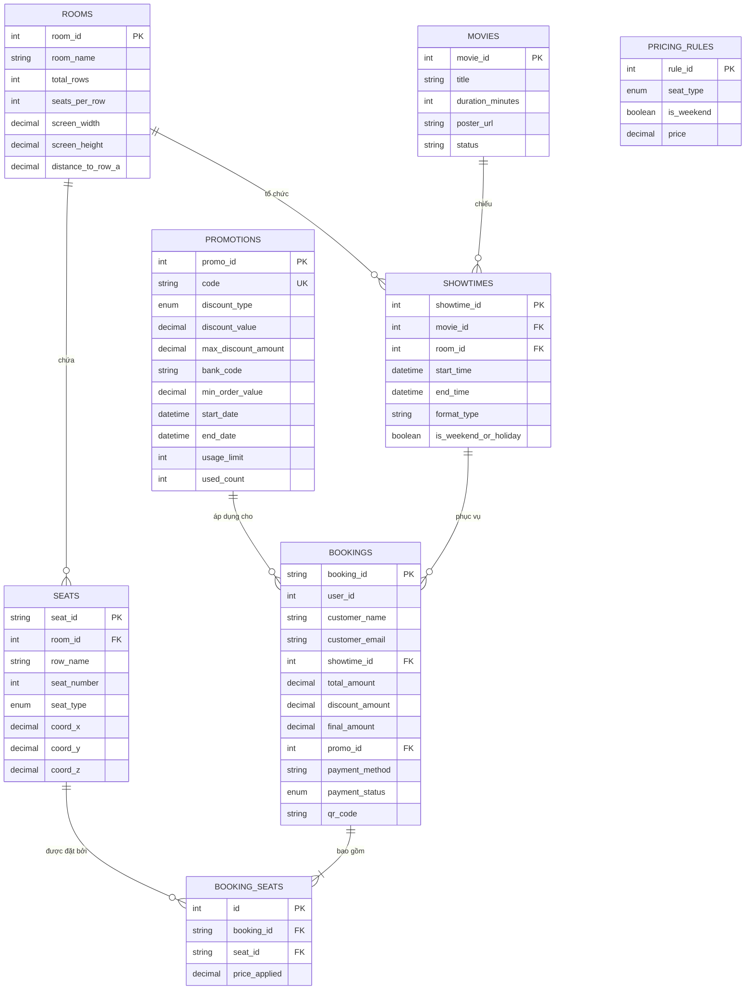

# 💾 THIẾT KẾ CƠ SỞ DỮ LIỆU (DATABASE SCHEMA SPECIFICATION)

Hệ thống lưu trữ dữ liệu chính trên hệ quản trị cơ sở dữ liệu quan hệ **MySQL 8.0** với bộ mã hóa chuẩn `utf8mb4` và collation `utf8mb4_unicode_ci`.

---

## 1. Sơ Đồ Thực Thể Liên Kết (Entity Relationship Diagram - ERD)

---

## 2. Chi Tiết Các Bảng Dữ Liệu

### A. Bảng `rooms` (Phòng chiếu)
Lưu trữ kích thước vật lý của phòng chiếu phục vụ tính toán Seat View Engine.
| Cột | Kiểu dữ liệu | Ràng buộc | Mô tả |
| :--- | :--- | :--- | :--- |
| `room_id` | INT | PK, AUTO_INCREMENT | Mã định danh phòng chiếu |
| `room_name` | VARCHAR(100) | NOT NULL | Tên rạp/phòng chiếu (VD: IMAX Laser 01) |
| `total_rows` | INT | NOT NULL | Tổng số hàng ghế trong phòng |
| `seats_per_row` | INT | NOT NULL | Số ghế tối đa mỗi hàng |
| `screen_width` | DECIMAL(5,2) | NOT NULL | Chiều rộng vật lý màn chiếu (mét) |
| `screen_height` | DECIMAL(5,2) | NOT NULL | Chiều cao vật lý màn chiếu (mét) |
| `distance_to_row_a` | DECIMAL(5,2) | NOT NULL | Khoảng cách từ màn hình đến hàng A (mét) |

### B. Bảng `seats` (Ghế ngồi & Tọa độ 3D)
Lưu vị trí tọa độ $(X, Y, Z)$ trong không gian thực của rạp.
* $X$: Khoảng cách phương ngang từ mép trái rạp sang phải (mét).
* $Y$: Khoảng cách phương dọc tính từ màn hình chiếu xuống cuối phòng (mét).
* $Z$: Chiều cao bậc sàn rạp nâng lên ở từng hàng ghế (mét).
* `seat_type`: Phân loại ghế:
  * `Standard`: Ghế tiêu chuẩn (Hàng A-C)
  * `VIP`: Ghế bọc đệm êm, góc nhìn vàng (Hàng D-G)
  * `Sweetbox`: Ghế đôi vách ngăn riêng tư (Hàng H)

### C. Bảng `pricing_rules` (Bảng giá vé linh hoạt)
Hệ thống tính giá dựa trên loại ghế và thời điểm suất chiếu (ngày thường vs cuối tuần).
* Standard ngày thường: 90.000 VNĐ | Cuối tuần: 110.000 VNĐ
* VIP ngày thường: 120.000 VNĐ | Cuối tuần: 140.000 VNĐ
* Sweetbox ngày thường: 220.000 VNĐ | Cuối tuần: 260.000 VNĐ

### D. Bảng `promotions` (Mã giảm giá & Ràng buộc ngân hàng)
* `bank_code`: Mã ngân hàng bắt buộc (VD: `"ACB"`, `"VCB"`). Nếu `NULL`, mã dùng được cho mọi phương thức.
* `discount_type`: `Percentage` (% giảm) hoặc `FixedAmount` (số tiền cố định).
* `max_discount_amount`: Chặn trần số tiền được giảm tối đa.

### E. Bảng `bookings` & `booking_seats`
Lưu trữ thông tin xuất vé, hóa đơn và liên kết ghế.
* `booking_id`: Chuỗi định danh duy nhất (VD: `BK-123456-A8B9C0`).
* `payment_status`: Trạng thái đơn: `Pending`, `Paid`, `Cancelled`, `Failed`.
* `qr_code`: Chuỗi token bảo mật để quét vé tại cổng rạp.

