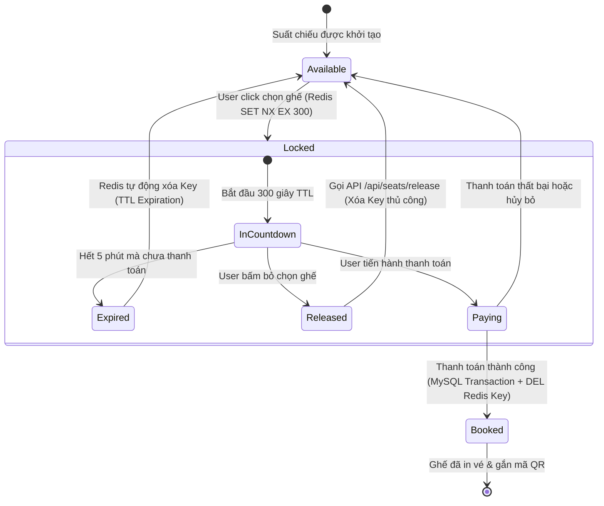

# 🔒 CƠ CHẾ KHÓA GHẾ THỜI GIAN THỰC (REDIS SEAT LOCKING ENGINE)

## 1. Vấn Đề Double-Booking Trong Hệ Thống Bán Vé
Khi một bộ phim bom tấn mở bán suất chiếu đặc biệt, hàng ngàn người dùng có thể cùng click vào một vị trí ghế VIP duy nhất (ví dụ: `R1-E07`) tại cùng một mili-giây.
* Nếu chỉ dựa vào Database MySQL thông thường, việc đọc-ghi đồng thời sẽ gây ra hiện tượng **Race Condition** (Tranh chấp tài nguyên) dẫn đến việc hai người cùng thanh toán thành công cho một chỗ ngồi.
* Khóa dòng truyền thống (`SELECT ... FOR UPDATE`) trên MySQL gây nghẽn kết nối (connection pool starvation) và làm tê liệt cơ sở dữ liệu.

---

## 2. Giải Pháp Redis Key-Value Với Nguyên Tử Tính (Atomic Lock)

Hệ thống **CineTicket Pro** sử dụng Redis làm tầng đệm khóa ghế phân tán:

### A. Cấu Trúc Khóa (Key Pattern)
```text
lock:showtime:{showtime_id}:seat:{seat_id}
```
* **Ví dụ:** `lock:showtime:1:seat:R1-E07`
* **Giá trị (Value):** `user_id` của khách hàng đang chọn (VD: `"1"`).
* **Thời gian sống (TTL - Time-To-Live):** `300` giây (5 phút).

### B. Lệnh Nguyên Tử Redis
Hệ thống thực thi câu lệnh Redis:
```redis
SET lock:showtime:1:seat:R1-E07 1 NX EX 300
```
* `NX` (Not Exists): Chỉ ghi nếu key **chưa từng tồn tại**. Đảm bảo nguyên tử tính tuyệt đối (Atomic Operation).
* `EX 300`: Thiết lập thời hạn hết hạn chính xác 300 giây.

### C. Phản Hồi Từ Redis
1. **Trả về `OK`:** Ghế được khóa độc quyền thành công cho `user_id`. Khách hàng chuyển sang bước thanh toán với đồng hồ đếm ngược 5:00 phút.
2. **Trả về `nil` / `null`:** Ghế đã bị giữ bởi một khách hàng khác $\rightarrow$ Hệ thống lập tức trả mã lỗi `409 Conflict` về Client:
   ```json
   {
     "success": false,
     "error": "Ghế R1-E07 đang được người khác giữ chỗ. Vui lòng chọn ghế khác!",
     "failed_seat": "R1-E07"
   }
   ```

---

## 3. Sơ Đồ Trạng Thái Vòng Đời Ghế (Seat Lifecycle State Diagram)



---

## 4. Xử Lý Khóa Theo Lô (Batch Seat Locking) & Rollback
Khi khách hàng chọn nhiều ghế (VD: đặt 3 ghế gia đình `R1-E06`, `R1-E07`, `R1-E08`):
* Hệ thống duyệt qua từng ghế và gọi khóa nguyên tử.
* Nếu ghế thứ 3 bị người khác khóa trước $\rightarrow$ **Kích hoạt cơ chế Rollback ngay lập tức**: Tự động giải phóng ghế 1 và ghế 2 để không chiếm dụng ghế dở dang.

---

## 5. Cơ Chế In-Memory Fallback Cho Môi Trường Phát Triển
Để nhà phát triển có thể clone dự án về và chạy ngay mà không bắt buộc phải cài đặt Redis Server:
* File `src/lib/redis.ts` tích hợp sẵn lớp `InMemoryLockManager`.
* Mô phỏng chính xác hành vi của Redis với phương thức `setNX(key, userId, ttlSeconds)` và một luồng background worker tự động dọn dẹp các key quá hạn mỗi 5 giây.
* Khi kết nối `REDIS_URL` hoặc `REDIS_HOST` được thiết lập, hệ thống sẽ tự động chuyển sang ioredis thật mà không cần thay đổi bất kỳ dòng code nào!
